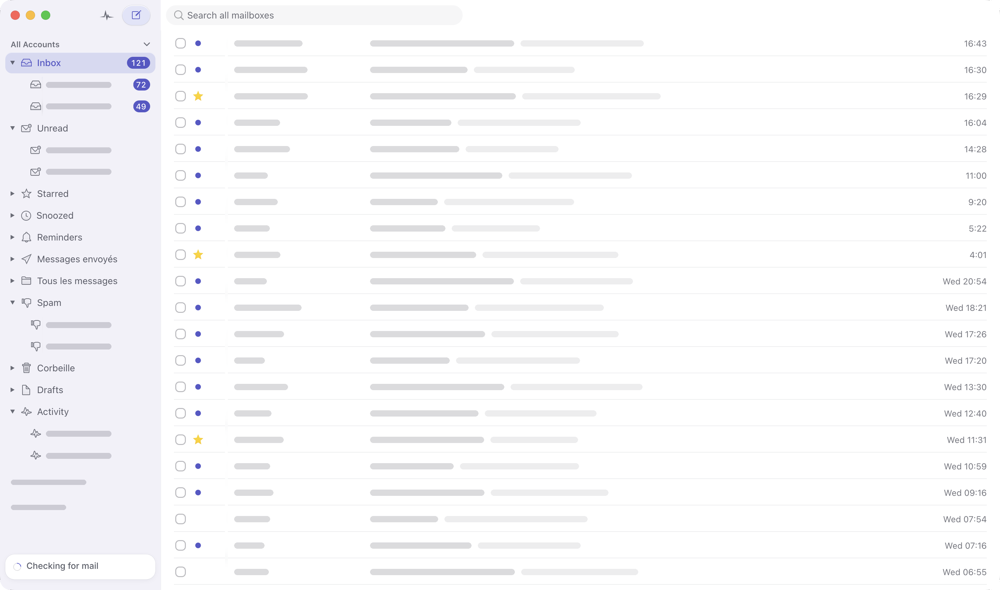
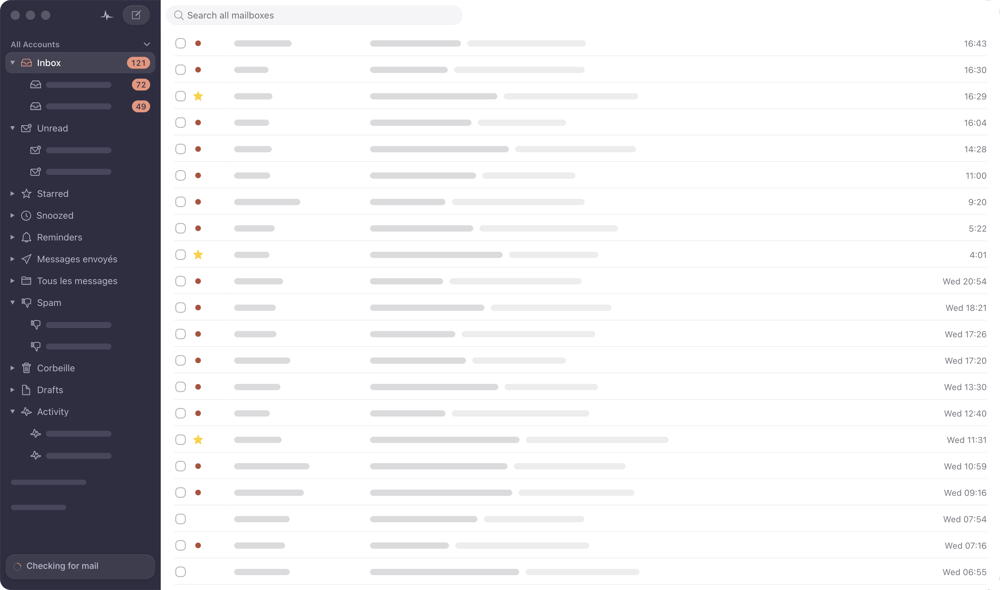
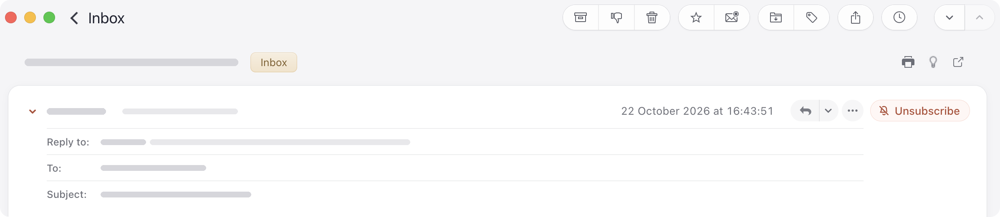
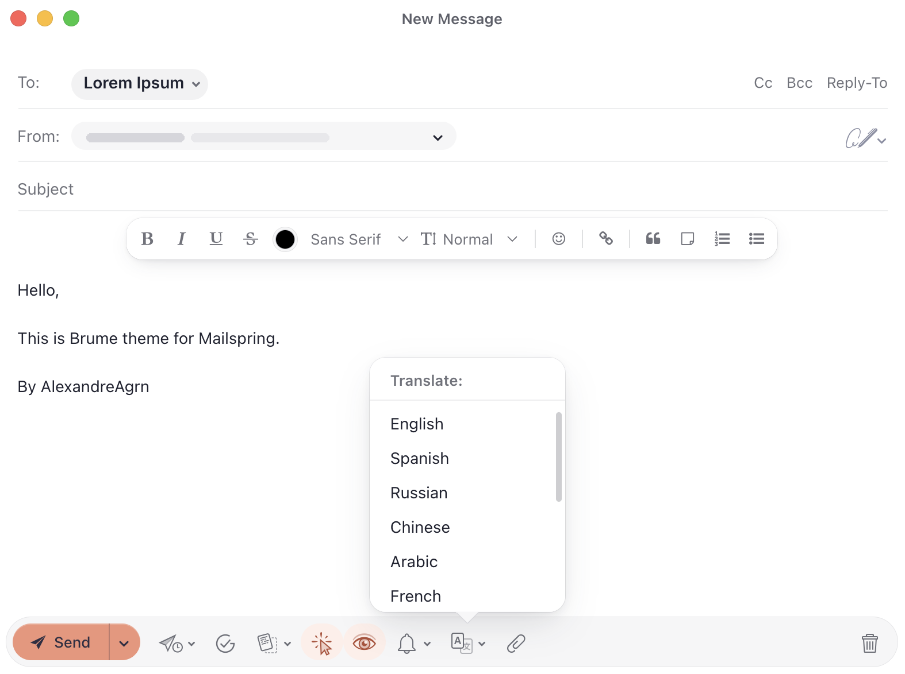

# Brume for Mailspring

Two light, minimal, pastel themes for [Mailspring](https://getmailspring.com), designed around Apple's Liquid Glass language (macOS 26).

- **Brume**: soft lavender chrome, periwinkle accent.
- **Brume Ardoise**: the same theme with a slate sidebar and a coral accent, a nod to the built-in Darkside theme.

Both themes share the exact same rules. Brume Ardoise only redefines color tokens, so layout, spacing, radii and behavior are identical in both.

## Install

1. Download the latest release, or clone this repository.
2. In Mailspring: **Mailspring > Install Theme...**, then select the `brume` or `brume-ardoise` folder.
3. **Mailspring > Change Theme...**, then pick the theme. In automatic (light/dark) mode, set it as the light theme in **Preferences > Appearance**.
4. **Quit Mailspring completely (Cmd+Q) and relaunch it.** Mailspring keeps a preloaded composer window that only sees themes installed before it opened, and reads sidebar widths and row heights at startup.

Both themes can be installed side by side.

## What's inside

- **Glass only where it belongs**: popovers, menus, search suggestions and dropdowns are frosted glass; content (message list, messages) stays opaque.
- **Concentric radii** on a single scale (6, 8, 10, 14, 20pt and capsules).
- **Continuous toolbar**: each toolbar segment takes the color of its column, no hard separators.
- **Sidebar**: resizable from 200 to 420pt (instead of 165 to 250pt), 32pt rows, right-aligned counters, traffic lights centered on the toolbar axis.
- **Message list**: rounded selection pills, subtle inset separators, visible checkboxes aligned with the unread dot, a gray star on hover to follow a thread.
- **Click to deselect**: clicking the empty area of the list closes the open message and clears the selection; clicking anywhere else removes the keyboard cursor frame. This is the only behavior that needs code (a small `lib/main.js`, loaded with the theme and removed when you switch themes).
- **Reading pane**: messages as cards, the reply area attached to the last card. Sender, date, reply and Unsubscribe on a single line; a chevron opens a clean details sheet (recipients, subject, folders).
- **Composer**: a floating formatting bubble that stays in view while scrolling, without jumping, and a floating capsule action bar.
- **Sync activity**: "Checking for mail" becomes a card with a thin spinner at the bottom of the sidebar.
- **Restyled components**: recipient tokens, attachments, undo toast, snooze popover, switches, preferences tabs, notifications, swipe colors, mini calendar, dropdown menus and native select boxes.
- **Accessibility**: respects Reduce transparency, Reduce motion and Increase contrast. Text colors meet WCAG AA.

## Customize

Everything is driven by tokens in `styles/ui-variables.less`:

- accent: `@brume-accent`;
- sidebar width bounds: `@brume-sidebar-min-width`, `@brume-sidebar-max-width`;
- list row heights: `@brume-thread-row-wide`, `@brume-thread-row-narrow`;
- follow the macOS accent color: see the comment in `styles/index.less`.

To make your own color variant, copy `brume-ardoise`, rename it in `package.json` (`name` and `displayName`), and change the color tokens at the end of `styles/ui-variables.less`.

## Known limitations

- Mailspring's window is opaque, so the desktop does not show through the sidebar as in native apps.
- Designed for macOS. It works on Windows and Linux, but the toolbar capsules are macOS-specific.
- Email bodies keep their own formatting.

## Credits

Brume Ardoise's slate and coral palette is inspired by Darkside by Jamie Wilson, one of Mailspring's built-in themes (MIT). Built on the [Mailspring Theme Starter](https://github.com/Foundry376/Mailspring-Theme-Starter).

## License

MIT
